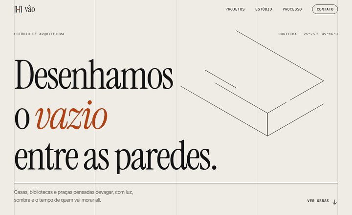
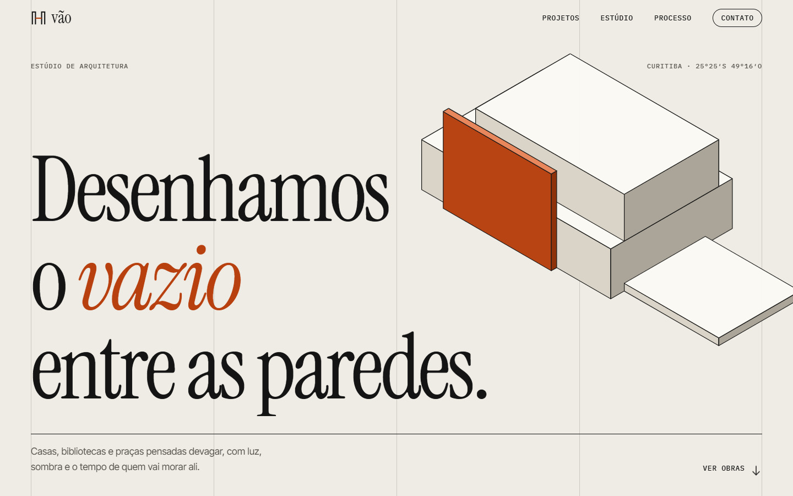
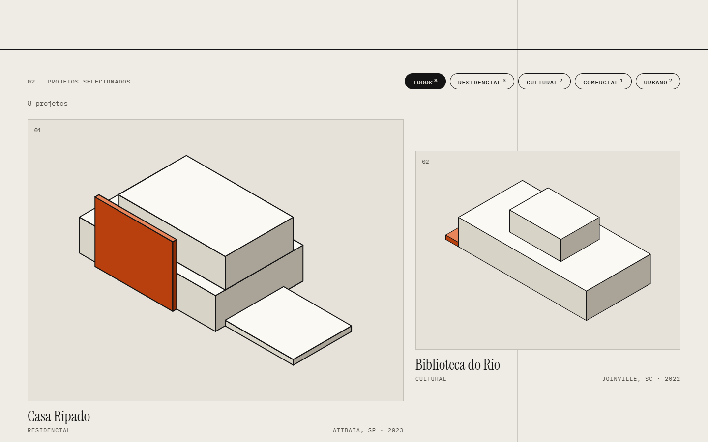
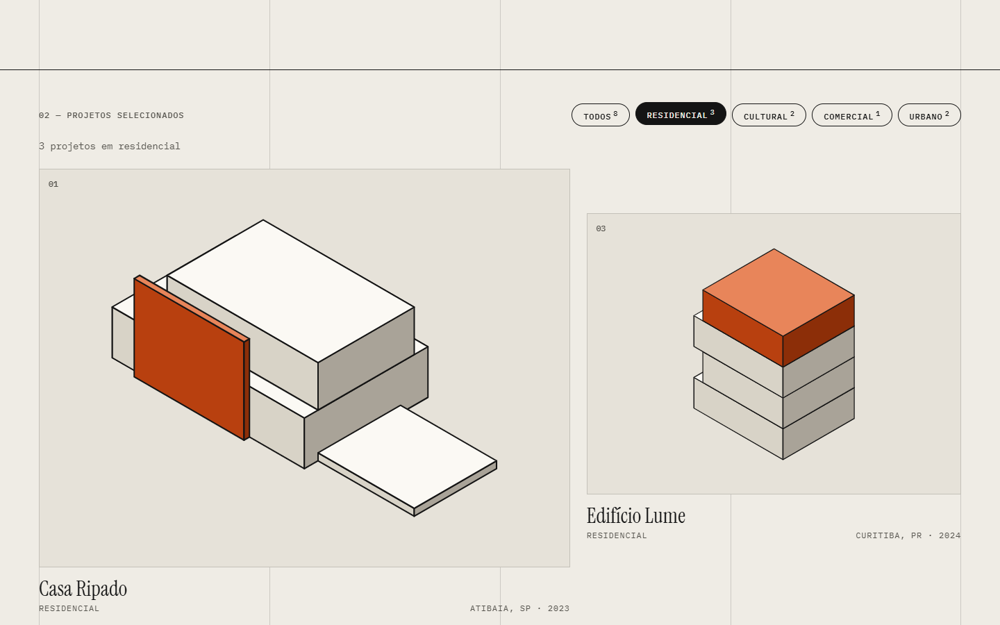
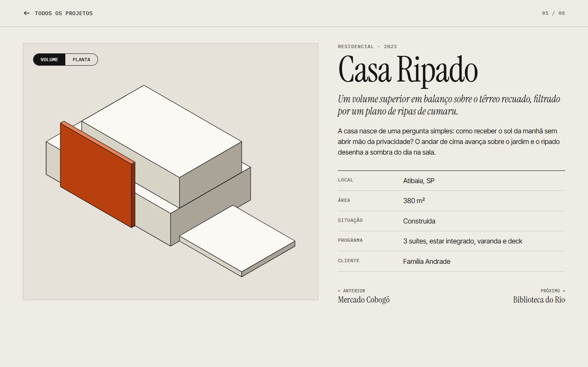
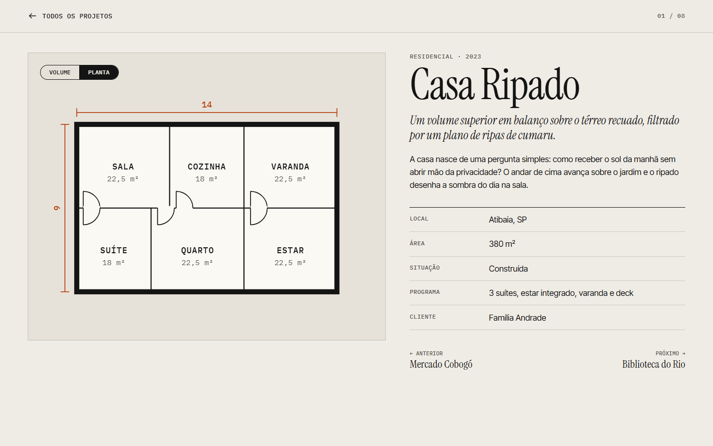
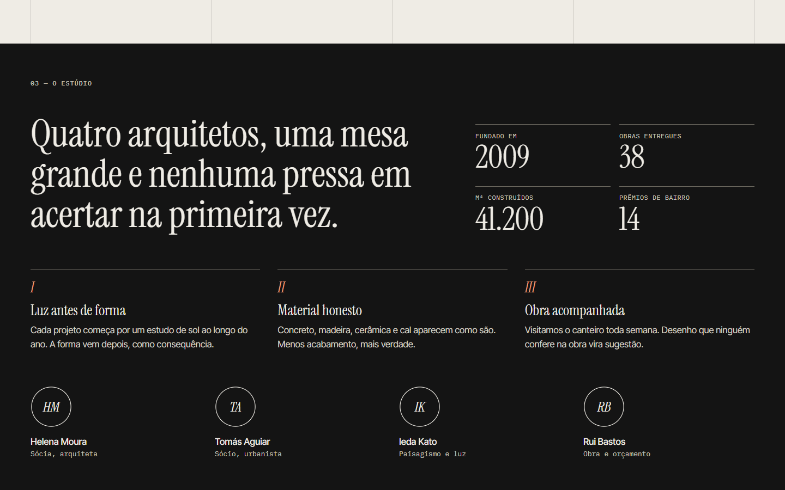
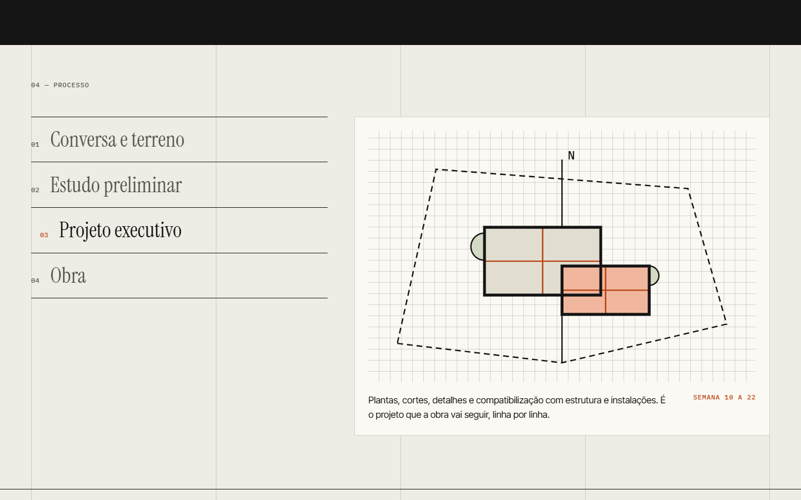
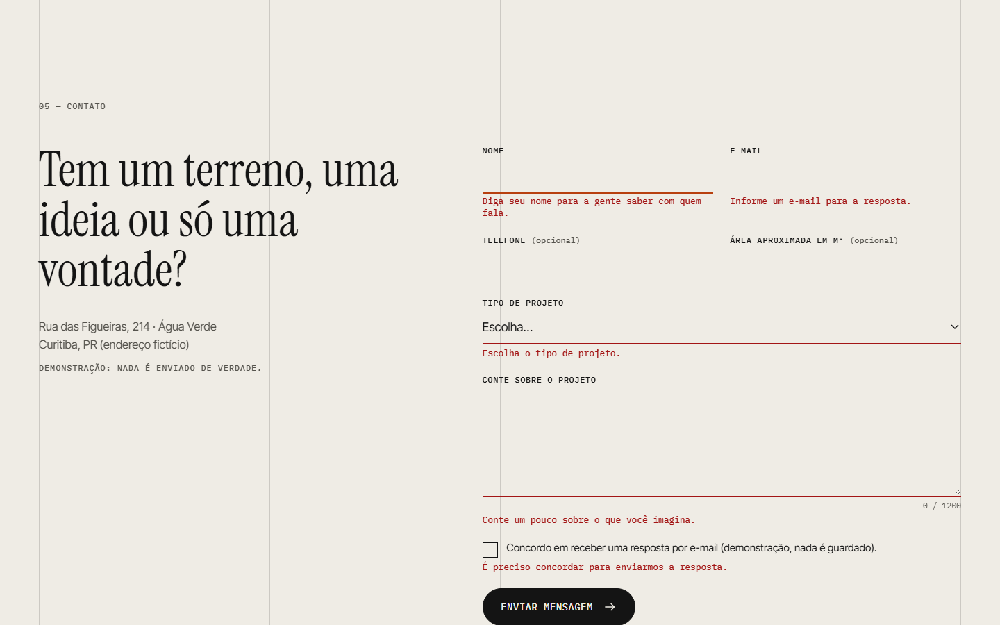
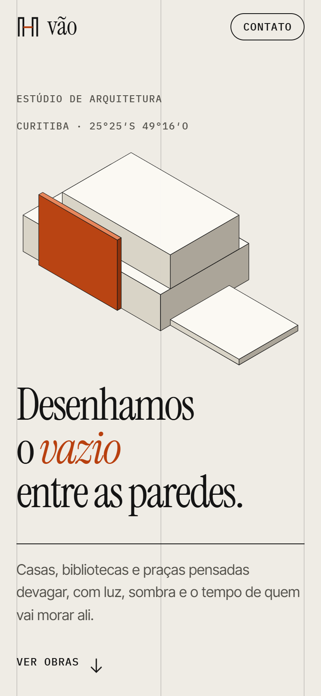

# Vão Arquitetura · Site de estúdio de arquitetura

Site editorial minimalista de um estúdio de arquitetura fictício: capa com axonometria que se desenha sozinha, galeria de projetos com filtro, página de cada obra com planta e volume gerados em SVG, processo em etapas e formulário de contato validado. HTML, CSS e JavaScript puros, sem build e sem backend.

[](https://github.com/luizrenatodc/site-estudio-arquitetura/actions/workflows/testes.yml)
[](LICENSE)

**Ao vivo:** <https://luizrenatodc.github.io/site-estudio-arquitetura/>

> **Demonstração.** O estúdio, os projetos, as pessoas, os clientes e o endereço são inventados. Nada do formulário sai do navegador.



## Veja funcionando



| Galeria de projetos | Filtro por tipo |
|---|---|
|  |  |

| Projeto em volume | Projeto em planta, com cotas |
|---|---|
|  |  |

| Estúdio | Processo |
|---|---|
|  |  |

| Formulário validado | Celular |
|---|---|
|  |  |

## O que tem

- **Desenho técnico em código.** Axonometria e planta saem de dados (`projetos.js`) por funções puras (`desenho.js`): projeção isométrica, ordenação das caixas do fundo para a frente e planta com paredes, portas, áreas e cotas.
- **Galeria com filtro** por tipo e **página de projeto** com rota por hash (`#/projeto/casa-ripado`), alternância volume/planta e navegação entre obras. A troca usa a View Transitions API quando o navegador oferece, e funciona sem ela.
- **Animação por rolagem**: manifesto que acende palavra por palavra, números que sobem, seções que entram, traçado das linhas na capa.
- **Formulário de contato** com validação por campo, máscara de telefone, contador, resumo de erros e foco no primeiro campo com problema.
- **Acessibilidade**: link de pular, foco visível, abas com setas, `aria-live`, diálogo com foco preso e Esc, `prefers-reduced-motion`.

## Como é feito

```
site/
  index.html
  css/estilo.css       paleta, grade, animações
  js/projetos.js       dados e consultas (sem DOM)
  js/desenho.js        axonometria e planta em SVG
  js/validacao.js      regras do formulário (sem DOM)
  js/app.js            interface
test/                  testes de lógica, estrutura do HTML e contraste
scripts/               servidor local, capturas e GIF
```

## Como rodar

```bash
npm start        # http://localhost:8080
npm test         # testes de lógica, HTML e contraste (WCAG AA)
```

Sem dependências. As fontes (Instrument Serif, Inter Tight e IBM Plex Mono) vêm do Google Fonts; sem internet o site usa fontes do sistema.

## Publicação

`pages.yml` publica a pasta `site/` no GitHub Pages a cada push em `main`; `testes.yml` roda os testes.

## Gerar as capturas e o GIF

```bash
PUPPETEER_DIR=/caminho/com/puppeteer-core node scripts/telas.mjs
python scripts/montar_gif.py 720      # requer Pillow
```

## Limites conhecidos

- **Dados e desenhos ilustrativos.** As plantas e volumes são esquemáticos, não projetos de verdade.
- **Sem backend.** O formulário só valida e mostra uma confirmação.
- **Isometria simples.** A ordenação das caixas cobre volumes que não se interpenetram; formas mais complexas pediriam recorte de faces.
- **Fontes externas** do Google Fonts.

## Sobre este projeto

Projeto de demonstração, com estúdio, obras e endereços fictícios, criado para mostrar design editorial, desenho em SVG e interface sem framework.

## Autor

**Luiz Renato Carvalho**, Engenheiro de Software e IA · [luizrenato.dev](https://www.luizrenato.dev) · [LinkedIn](https://linkedin.com/in/luizrenatodc)
